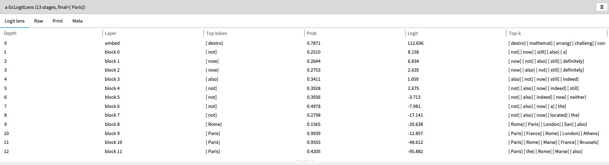
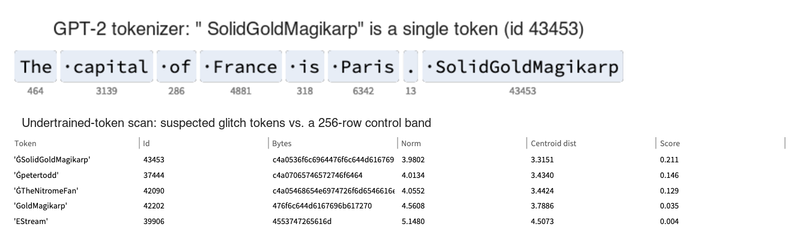
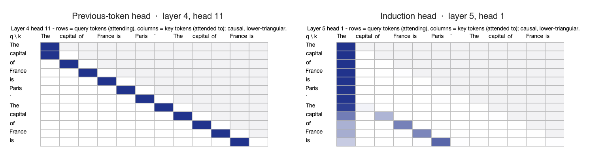
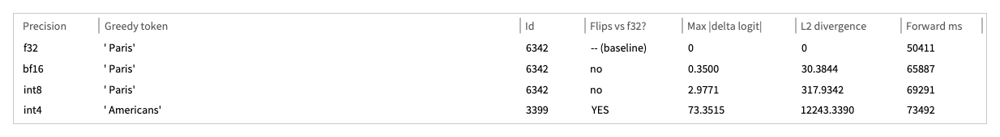
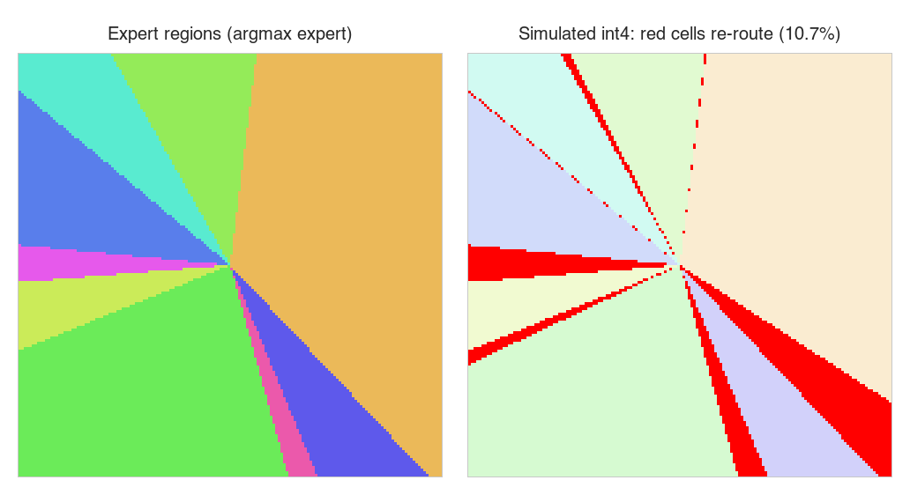
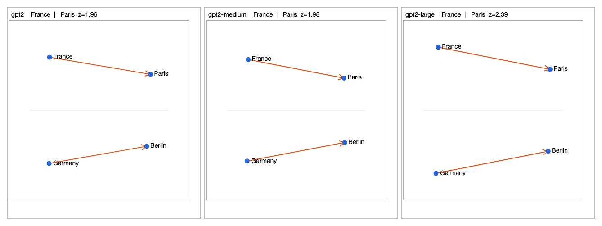
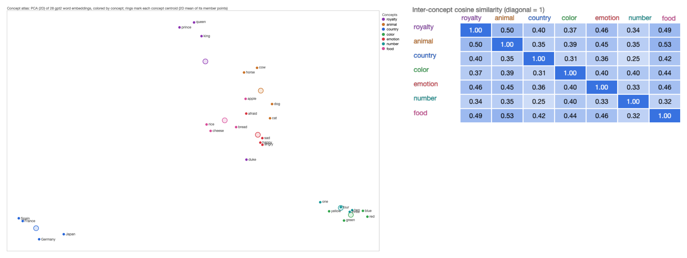

# Glass Case (gt4glasscase)

**Inspect language models as live objects.** Glass Case is a model-inspection workbench for [Glamorous Toolkit](https://gtoolkit.com). It includes **GlassBox**, a GPT-2 (124M) implemented in pure Smalltalk: no Python, no ONNX, no native ML runtime. Every intermediate value (tokens, residual streams, attention patterns, logits, quantized weights) is an object you can click into, with views built for the question you're asking.



*The logit lens on "The capital of France is Paris. The capital of France is", inspected live in GT. Each row decodes the residual stream at one depth: early layers guess filler (" not", " now"), block 8 tries " Rome", and from block 9 on the model settles on " Paris". Every row is an object you can click into. Logits are post-`ln_f` and unnormalized, so compare probabilities down the column, not logits: softmax ignores a constant shift, and GPT-2's logit offset drifts with depth.*

> **Status:** research prototype. APIs will change. Claims below are scoped to what the code demonstrates; see [Limitations](#limitations-and-honest-caveats).

**Highlights:**
- **Watch the answer form.** On the prompt above, GPT-2's middle layers guess " Rome" before settling on " Paris" at block 9.
- **Recover known circuits.** Scoring all 144 attention heads on the repeated prompt ranks L4H11 first and L2H2 second as previous-token heads, and puts L5H5 and L6H9 in the top five induction heads. Those are the heads Wang et al. (2022) named in their GPT-2 circuit analysis.
- **Catch precision-dependent behavior.** The same weights say " Paris" at f32, bf16 and int8, and " Americans" at naive int4.
- **Inspect a 7B MoE router without downloading the model.** One ~256 KB tensor from OLMoE-1B-7B, fetched over HTTP range requests, is enough to map its expert regions and show that 10.7% of a 2-D slice of its input space re-routes under simulated int4.
- **Report the negative results too.** Hand-picked concept axes (gender, sentiment, size, royalty) are no more orthogonal than random word-set axes, and the [caveats](#limitations-and-honest-caveats) give the numbers.

---

## What it does

**Look at a checkpoint without downloading it**
- Parses safetensors headers (single and sharded) and reads only the byte ranges it needs from Hugging Face over HTTP. Examples: a few KB per embedding row, never the whole matrix.
- Architecture views derived from metadata alone: signal-flow block diagram (attention / SSM / MoE / vision towers), tensor tree, per-layer "skyline" with regularity z-scores, cross-checkpoint config and parameter-budget comparisons.
- Tokenizer forensics: BPE merge-list objects, suspected hand-inserted merges, and undertrained ("glitch") token candidates scored by embedding-row norm and distance from a control band.



*Top: the tokenizer view, where " SolidGoldMagikarp" is a single GPT-2 token. Bottom: five documented glitch tokens scored against a control band of 256 ordinary rows, using six HTTP range reads of `openai-community/gpt2`'s 50,257 × 768 embedding matrix, never the whole file. The result is negative, and the example asserts that it is: with a centroid estimated from only 256 rows, these tokens don't separate. Their median norm (4.06) sits above the control band's (3.44) and their scores stay low. The published "near the centroid" finding uses a full-vocabulary centroid, which is follow-up work.*

**Run GPT-2 natively and watch it compute**
- Byte-level BPE tokenizer (matches reference token ids), full forward pass, greedy generation.
- KV cache, verified byte-identical to the uncached path.
- Logit lens across all 13 depths and per-head causal attention heatmaps.



*Two heads from the same forward pass on the France prompt. Left: L4H11 puts essentially all of its attention (1.00 on average) on the previous token. Right: in the repeated half, L5H1 attends to the token that followed the current one the first time ("capital" → "of", …, "is" → "Paris"). That is the induction pattern associated with in-context copying. Induction score here means the mean attention from the four repeated positions to their "next token last time" position. L5H1 scores highest (0.58), then L8H6 (0.40), L10H7 (0.37), L5H5 (0.33) and L6H9 (0.30). The previous-token scores rank L4H11 (1.00) first and L2H2 (0.60) second. L4H11 and L2H2 are the previous-token heads, and L5H5 and L6H9 the induction heads, that Wang et al. (2022) identified in GPT-2 small. This is one 12-token prompt, so treat it as a demonstration, not a head census.*
- Swappable kernels with a correctness gate: naive float64 reference, blocked matmul, f32 storage, and optional Accelerate BLAS on macOS (automatic fallback elsewhere).

**Security-oriented lenses**
- **Precision-differential audit:** the same forward pass at f32 / bf16 / int8 / int4, reporting whether the greedy token flips and how far the logits move. The question it's built to ask: *does a model behave at one precision and misbehave at another?*
- **MoE router region maps:** the expert tessellation on a 2-D slice of router-input space, plus the cells that re-route under simulated int4.



*The same GPT-2 forward pass at four precisions on the "capital of France" prompt. bf16 and int8 keep " Paris"; naive int4 flips the answer to " Americans" (max logit shift 73.4). Forward times are cold runs, each including a ~500 MB weight decode.*



*The layer-0 router of `allenai/OLMoE-1B-7B-0924` (64 experts), fetched as a single ~256 KB tensor over HTTP range requests. Left: which expert wins across a 2-D slice of router-input space (basis: the router's top-2 right singular vectors; 9 of 64 experts appear in this slice). Right: under simulated symmetric int4 round-to-nearest, 10.7% of the grid cells, in red, route to a different expert. That is a mechanism demonstration, not the model's real quantized codebook.*

**Concept and embedding explorer**
- Word-embedding geometry across GPT-2 sizes and precisions, with a random-pair baseline (z-scores) so raw cosines aren't compared across models naively.
- Concept atlas, concept-relationship graph, contrastive concept axes (linear-representation-hypothesis style), and behavioral probing ("A *dog* is a kind of ___").



*The same four words in GPT-2 small, medium and large (the latter two read row by row over HTTP), projected into a shared frame drawn at one scale. The x-axis is defined as the average country → capital direction, so the arrows point right by construction. What carries information is how well the two arrows agree in length and tilt. The z-score in each title is the France–Paris cosine against random word pairs in that model: 1.96, 1.98 and 2.39.*



*Left: 28 hand-picked words in GPT-2's embedding space (2-D PCA), colored by concept, with rings at the concept centroids. Countries, numbers and colors form tight clusters. Right: cosine similarity between concept centroids. Hand-picked word lists make this an illustration, not a finding (see caveats).*

**Experiment harness (partly scaffolding)**
- Domain objects for pre-registered hypotheses (immutable once sealed), seed-only noise floors, replications, and a refutation ledger that is never deleted.
- Campaign planning that emits only the jobs not yet run, with backend objects for Modal and RunPod. These are early and not yet the main path.

## Why Smalltalk / Glamorous Toolkit?

Interpretability work is mostly *looking*. In GT, each object carries its own custom views, so a logit-lens stage, an attention head, or a quantization comparison isn't a plot you regenerate. It's a live object you drill into, and the view travels with the object. The cost is speed: this is an interpreted VM, so it runs at teaching/inspection speed, not production speed.

## Requirements

- **Glamorous Toolkit:** tested on GT v1.1.626 on macOS 27 (Apple silicon). Other recent releases should work.
- **Disk:** ~550 MB for the GPT-2 (124M) files.
- **Memory:** ~1 GB free for decoded weights at the default float64 (~475 MB with f32 storage).
- **Network:** only for the Hugging Face inspection features and the one-time weight download.
- **Platform:** anything GT runs on. The optional BLAS speed-up uses macOS Accelerate; other platforms fall back to the pure-Smalltalk kernels automatically.

## Install

In a Glamorous Toolkit playground:

```smalltalk
Metacello new
    repository: 'github://dweinstein/gt4glasscase:main/src';
    baseline: 'Gt4GlassCase';
    load.
```

Then register the walkthrough notebook (Lepiter page):

```smalltalk
#BaselineOfGt4GlassCase asClass loadLepiter
```

### Get the GPT-2 weights (one time)

GlassBox reads the standard Hugging Face files from `~/.cache/glassbox/gpt2/`:

```sh
mkdir -p ~/.cache/glassbox/gpt2 && cd ~/.cache/glassbox/gpt2
for f in model.safetensors config.json vocab.json merges.txt; do
  curl -L -O "https://huggingface.co/openai-community/gpt2/resolve/main/$f"
done
```

Other GPT-2-family checkpoints (e.g. `distilgpt2`, `gpt2-medium`) go in sibling folders and open with `GcGpt2Model openCheckpoint: 'gpt2-medium'`.

Optional: for gated Hugging Face repos, put a token in `~/.secrets/huggingface-token.txt`. It's read from that file and never printed.

## Quick start

Open the **"GlassBox — a pure-Smalltalk GPT-2, moldably"** Lepiter page, or evaluate these and inspect the results:

```smalltalk
"Load (weights stay lazy until used). Views: Overview / Model / Signal flow / Tree / Skyline."
GcGpt2Model default.

"Tokenize; inspect the Tokenized view."
GcTokenizer gpt2 encodingFor: 'The capital of France is'.

"Generate with the KV cache (~30 s warm). Greedy -> ' Paris'."
GcGpt2Model default
    generateCachedFromTokenIds: (GcTokenizer gpt2 encode: 'The capital of France is Paris. The capital of France is')
    maxTokens: 8.

"Precision-differential audit (slow: several minutes)."
(GcPrecisionComparison promptIds: (GcTokenizer gpt2 encode: 'The capital of France is Paris. The capital of France is'))
    runWith: GcGpt2Model openDefault
    precisions: #(f32 bf16 int8 int4).
```

The screenshots come from these example methods, each of which you can run and inspect:

| Figure | Example | Time |
|---|---|---|
| Logit lens, attention heatmaps | `GcInterpretabilityExamples>>franceLogitLensAndAttentionExample` | ~1 min |
| Head scores (previous-token, induction) | `GcInterpretabilityExamples>>attentionHeadRolesExample` | ~1 min |
| Precision table | `GcPrecisionExamples>>precisionDifferentialExample` | ~4 min |
| OLMoE router map | `GcHuggingFaceExamples>>liveOlmoeRouterRegionMap` | seconds, network |
| Glitch tokens | `GcHuggingFaceExamples>>liveGpt2UndertrainedGlitchTokens` | seconds, network |
| Analogies across sizes | `GcEmbeddingComparisonExamples>>remoteSizeComparisonExample` | seconds, network |
| Concept atlas | `GcConceptSpaceExamples>>defaultGpt2ConceptSpaceExample` | seconds |

`attentionHeadRolesExample` asserts the head rankings quoted in the attention caption. It fails if L4H11 stops being the top previous-token head, or if L5H5 or L6H9 leaves the top five induction heads.

The executable documentation lives in `GcGpt2InferenceExamples`, `GcInterpretabilityExamples`, `GcPrecisionExamples`, `GcGpt2MathExamples`, and `GcExamples`, plus the Hugging Face client examples (180 `gtExample` methods in total). Hermetic examples need no network or weights. Those marked `<noTest>` are end-to-end and need the local GPT-2 files.

## Limitations and honest caveats

- **Scale.** The native forward pass is GPT-2 (124M) and its family only, at interpreted-VM speed. The metadata/inspection tools handle much larger and sharded checkpoints, but they don't *run* them.
- **The int4 flip is a demonstration of the audit, not an attack.** Naive per-row round-to-nearest int4 is expected to damage a 124M model; " Paris" → " Americans" shows the tool detecting a precision-dependent behavior change. The real threat it's aimed at is *engineered* precision-conditional behavior: models that look benign in full precision but turn malicious when quantized (Egashira et al., 2024).
- **Concept-axis angles need a baseline, and these don't beat it.** The four example axes (gender, sentiment, size, royalty; four words per pole) come out 87.2–95.1° apart. Axes built the same way from *random* four-word sets (1,000 pairs drawn from 19,386 single-token lowercase words, GPT-2 f32 embeddings) average 90.1° ± 3.1°, with 95% between 84.1° and 96.2°, and 78% land in the same 87–95° band. So in the static embedding table, near-orthogonality here is what any two word-set contrasts give you. It is not evidence of disentangled concepts.
- **Small samples.** Concept and behavioral examples use handfuls of words (e.g. 7 words, 4/7 agreement). Treat them as illustrations, not findings.
- **2-D slices.** Router region maps are 2-D slices of a high-dimensional space with the basis named in each caption, and the quantization view simulates symmetric RTN rather than a production codebook.
- **Data-mixture inference** is a scaffold: inputs and boundary only, no solver.

## Related work

- Egashira, Vero, Staab, He, Vechev. *Exploiting LLM Quantization.* NeurIPS 2024. [arXiv:2405.18137](https://arxiv.org/abs/2405.18137)
- nostalgebraist. *Interpreting GPT: the logit lens.* 2020.
- Olsson et al. *In-context Learning and Induction Heads.* Transformer Circuits Thread, 2022.
- Wang, Variengien, Conmy, Shlegeris, Steinhardt. *Interpretability in the Wild: a Circuit for Indirect Object Identification in GPT-2 small.* 2022. [arXiv:2211.00593](https://arxiv.org/abs/2211.00593)
- Land & Bartolo. *Fishing for Magikarp: Automatically Detecting Under-trained Tokens in Large Language Models.* 2024.
- Hayase et al. *Data Mixture Inference: What do BPE Tokenizers Reveal about their Training Data?* 2024.
- Thomas Dullien's geometric view of ReLU networks as folded piecewise-linear maps (the inspiration for the router region maps).

## Project layout

| Package | Contents |
|---|---|
| `Gt4GlassCase` | Core domain: model sources, tensors, GlassBox GPT-2, views, harness objects |
| `Gt4GlassCase-HuggingFace` | Adapter connecting the core to the Hugging Face client |
| `Gt4HuggingFace` | Standalone Hugging Face Hub client and safetensors header reader (no Glass Case dependency) |
| `lepiter/` | Walkthrough notebook |

## License

MIT. See [LICENSE](LICENSE).

## Acknowledgements

Built on [Glamorous Toolkit](https://gtoolkit.com) by feenk.
